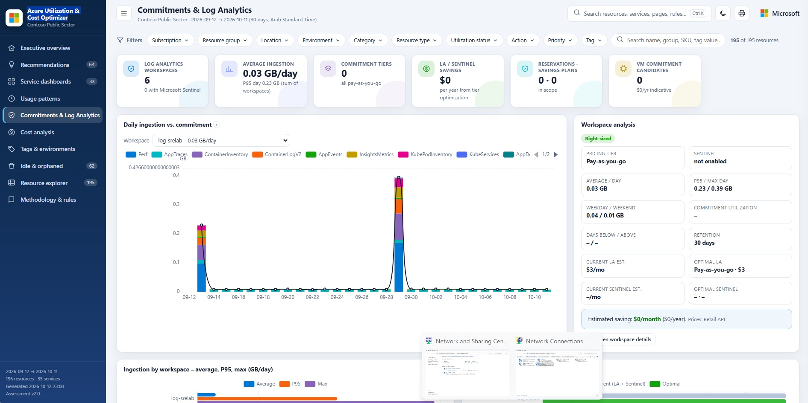

# Azure Utilization & Cost Optimizer

A read-only PowerShell utility that measures **what is provisioned vs. what is actually used** across your Azure
subscriptions — compute, PaaS, databases, storage, networking, AI and consumption services including Log Analytics and
Microsoft Sentinel — and produces a master Excel workbook, one workbook per resource type and an interactive HTML
dashboard with right-sizing and optimization recommendations.

## What you need

- **PowerShell 7** or later
- **Azure CLI** (`az`) or the **Az PowerShell** module, to sign in to Azure
- **ImportExcel** PowerShell module — installed automatically by the script if missing
- **Read-only** access to the subscriptions: **Reader**, **Monitoring Reader**, **Log Analytics Reader**
  and **Cost Management Reader** (for cost data)

The scripts make **no changes** to your environment.

## The three scripts

| Script | Role |
|---|---|
| **`Start-AzureCostOptimizationAssessment.ps1`** | **The only file you run.** Checks prerequisites and sign-in, then runs Phase 1 and Phase 2 into one timestamped output folder. |
| `Phase1-CollectUtilization.ps1` | Collects the data (read-only): all resources with their properties and tags, hourly utilization metrics, Log Analytics / Sentinel daily ingestion, cost, Azure Advisor and pricing. |
| `Phase2-AnalyzeAndReport.ps1` | Analyzes provisioned vs. utilized capacity and creates the Excel workbooks, recommendations and the HTML dashboard. No Azure calls. |

Keep all three scripts in the same folder.

## Option 1 — Run from any PC (Windows, macOS or Linux)

Requires PowerShell 7 and Azure CLI (or Az PowerShell) installed on the PC.
On Windows: `winget install --id Microsoft.PowerShell` and `winget install --id Microsoft.AzureCLI`.

```powershell
# 1. Download the scripts (or download the three .ps1 files into one folder)
git clone https://github.com/zhshah/Azure-Cost-Optimizer-Utility.git
cd Azure-Cost-Optimizer-Utility

# 2. Sign in to Azure (use one of the two)
az login --tenant <tenant-id>
# Connect-AzAccount -TenantId <tenant-id>

# 3. Run the assessment (from pwsh)
.\Start-AzureCostOptimizationAssessment.ps1 -CustomerName "Contoso"
```

> If the files were downloaded with a browser on Windows, unblock them first: `Get-ChildItem *.ps1 | Unblock-File`

## Option 2 — Run from Azure Cloud Shell

No installation needed — Cloud Shell already has PowerShell, Azure CLI and Az modules and you are already signed in.

1. Open [https://shell.azure.com](https://shell.azure.com) (or the Cloud Shell icon in the Azure portal) and select **PowerShell**.
2. Run:

```powershell
git clone https://github.com/zhshah/Azure-Cost-Optimizer-Utility.git
cd Azure-Cost-Optimizer-Utility
./Start-AzureCostOptimizationAssessment.ps1 -CustomerName "Contoso"
```

3. Zip the results and download the zip with **Manage files → Download** in the Cloud Shell toolbar
   (path: `Azure-Cost-Optimizer-Utility/CostOptimizationAssessment.zip`):

```powershell
Compress-Archive -Path ./CostOptimizationAssessment_* -DestinationPath ./CostOptimizationAssessment.zip
```

> Cloud Shell sessions close after 20 minutes without interaction — for very large environments use Option 1.

## Command syntax

```powershell
.\Start-AzureCostOptimizationAssessment.ps1 -CustomerName "<Customer name>"
    [-TenantId "<tenant-id>"]
    [-SubscriptionIds "<subscription-id-1>","<subscription-id-2>"]
    [-LookbackDays 30]
    [-CostHistoryMonths 6]
    [-NoOpen]
```

| Parameter | Description |
|---|---|
| `-CustomerName` | **Required.** Name used in the report titles and file names |
| `-TenantId` | Tenant to assess (default: the signed-in tenant) |
| `-SubscriptionIds` | Specific subscriptions (default: all enabled subscriptions you can read) |
| `-LookbackDays` | Utilization window in days, 7–93 (default 30) |
| `-CostHistoryMonths` | Months of monthly cost history (default 6) |
| `-NoOpen` | Do not open the HTML dashboard at the end |

Examples:

```powershell
# All subscriptions in the signed-in tenant
.\Start-AzureCostOptimizationAssessment.ps1 -CustomerName "Contoso"

# Two subscriptions, 60-day window, 12 months of cost history
.\Start-AzureCostOptimizationAssessment.ps1 -CustomerName "Contoso" -SubscriptionIds "<sub-id-1>","<sub-id-2>" -LookbackDays 60 -CostHistoryMonths 12

# Re-create the reports from collected data only (no Azure calls)
.\Phase2-AnalyzeAndReport.ps1 -InputPath .\CostOptimizationAssessment_<timestamp> -CustomerName "Contoso"
```

## Output

A folder `CostOptimizationAssessment_<timestamp>` containing:

- `<Customer> - Utilization & Cost Optimization Report.xlsx` — master workbook (executive overview, recommendations, action tracker, one sheet per resource type)
- `ResourceTypes\<Type>.xlsx` — one workbook per resource type with daily utilization
- `<Customer> - Utilization & Optimization Dashboard.html` — interactive dashboard (works offline)
- `Recommendations.csv` and `01_RawData\` (raw data exports)

Savings figures are estimates — validate with resource owners before making changes.

---

**Solution Developed by:**<br>
Zahir Hussain Shah<br>
Senior Solution Engineer, Cloud & AI - Infra<br>
Microsoft Qatar
